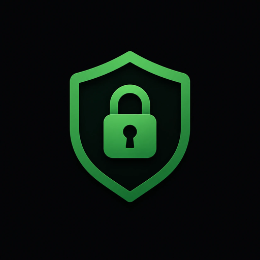

# PassMan for Linux

A local desktop password manager. Your vault is a single AES-256-GCM
encrypted file. There is no account and no service behind it: it works
entirely offline, and if you want two PCs in step you run the sync server
yourself, on your own hardware.

**`main` is 1.0.0-alpha.1, a PassMan 3 test version — for the lab only.**
For real use keep the [0.9.0 release](https://github.com/usermaneGermane/PassMan-Client-Linux/releases/tag/v0.9.0),
which the rest of this README describes. It installs from a `.deb` on Ubuntu
22.04 or newer, or runs from source. It has so far been tested in CI only,
on a virtual display, not yet on a real desktop.



| Repository | What it holds |
|---|---|
| [PassMan-Client-Windows](https://github.com/usermaneGermane/PassMan-Client-Windows) | the app for Windows |
| **PassMan-Client-Linux** (this one) | the app for Linux |
| [PassMan-Server-Windows](https://github.com/usermaneGermane/PassMan-Server-Windows) | the sync server for Windows, with an installer |
| [PassMan-Server-Linux](https://github.com/usermaneGermane/PassMan-Server-Linux) | the sync server for Linux, run by systemd |

**Same vaults as on Windows.** The vault file, the sync protocol and the
features match PassMan for Windows (see the version table under *What is
different from Windows*): 0.9.0 = Windows 2.11.0, and this test version =
Windows 3.0.0-alpha.1.
A vault moves between a Windows PC and a Linux PC unchanged, and both sync
with either server.

## PassMan 3 — the test version

1.0.0-alpha.1 is the same as [PassMan for Windows
3.0.0-alpha.1](https://github.com/usermaneGermane/PassMan-Client-Windows#passman-3--a-test-version-for-the-lab-only):
accounts with a Secret Key and a 12-word recovery phrase, Argon2id, and
importing 2.x vaults with their history. It opens PassMan 3 accounts only,
so do not install it over 0.9.0 — your vaults would not show up (they are
not changed). No sync yet. On Linux:

- **The Secret Key is kept under your master password** (Argon2id, then
  AES-GCM), not by the system as Windows does with DPAPI. So a copy of the
  account folder opens on another PC with the master password alone; keep
  your backups as private as your vault files. The desktop keyring may take
  this over later.
- The account folders are `700` and their files `600`, like the vault
  folder; a saved Emergency Kit is `600` too.
- *Settings → Backup → Open folder* opens the folder with `xdg-open`.
- The package spells the version `1.0.0~alpha.1`, which apt sorts after
  0.9.0 and before 1.0.0.

| File | What it is |
| --- | --- |
| `accounts/<name>/account.json` | nothing secret, and the Secret Key sealed under your master password |
| `accounts/<name>/keyset.pmk` | the account's keys, under master password + Secret Key |
| `accounts/<name>/recovery.pmk` | the same keys, under the 12-word recovery phrase |
| `accounts/<name>/vaults/<id>.pmv3` | your entries (+ `.bak`) |

They sit beside the `vault` folder below, which the test version only reads.

## Installing it

The package is `passman_<version>_all.deb`. Download it from
[Releases](https://github.com/usermaneGermane/PassMan-Client-Linux/releases)
(checksums in `SHA256SUMS.txt`), take the newest build from the
`passman-deb` artifact of the latest CI run on `main`
(`gh run download -R usermaneGermane/PassMan-Client-Linux -n passman-deb`),
or build it yourself on Ubuntu or Debian:

```bash
sudo apt install git python3-pip
git clone https://github.com/usermaneGermane/PassMan-Client-Linux.git
cd PassMan-Client-Linux
python3 deb/build_deb.py          # writes build/passman_<version>_all.deb
```

Then install it — apt pulls in Tk, cryptography, Argon2 (`python3-argon2`, in
the *universe* section, on by default on Ubuntu desktops) and Pillow from Ubuntu:

```bash
sudo apt install ./build/passman_*_all.deb
```

PassMan is then in the application menu, and `passman` starts it from a
terminal. `sudo apt remove passman` removes the program and leaves your
vaults alone.

| Installed file | What it is |
| --- | --- |
| `/usr/bin/passman` | starts the app |
| `/usr/lib/passman/` | the program and the libraries it bundles (customtkinter, darkdetect, packaging — pinned by hash in `deb/vendor.txt`) |
| `/usr/share/applications/passman.desktop` | the menu entry |

## Running from source

On Ubuntu 22.04 or newer (other desktops with Python 3.10+ and Tk work the
same way):

```bash
sudo apt install python3-tk python3-venv git
git clone https://github.com/usermaneGermane/PassMan-Client-Linux.git ~/PassMan-Client-Linux
cd ~/PassMan-Client-Linux
python3 -m venv .venv
.venv/bin/pip install -r requirements.txt
.venv/bin/python sourceFiles/gui.py
```

After that, starting it is the last line, from that folder.

## Where your data lives

Run from a checkout, as above, the files are in the checkout itself, next
to `sourceFiles/` — the same rule as a portable copy on Windows. The
package keeps them in **`~/.local/share/passman`**
(or `$XDG_DATA_HOME/passman`) instead, so that upgrading or removing it never
touches them. `PASSMAN_DATA_DIR` points the app at any other vault folder.

**Lab and production.** The package is the production copy. A checkout is a
handy lab copy beside it: it never touches `~/.local/share/passman`, and its
window title says `[LAB - <its vault folder>]` (the package's never does).
If both sync to the same server, give lab vaults names your real vaults do
not use — the server keeps one vault per username, so a lab vault with a
real vault's name would sync into it.

| File | What it is |
| --- | --- |
| `vault/<user>.vault.enc` | your encrypted vault |
| `vault/<user>.vault.enc.bak` | the previous version, kept automatically |
| `vault/<user>.vault.enc.base` | what the server held at the last sync, and which server that was; only if you sync |
| `config.json` | non-secret preferences (last username, auto-lock delay, sort order) |

The vault files are readable by your user only (`600`), and so is the
`vault` folder (`700`) when PassMan creates it. A plaintext CSV export is
created `600` too — it holds every password in the clear, so delete it once
it has done its job.

**Moving a vault from Windows:** copy `%APPDATA%\PassMan\vault\<user>.vault.enc`
into the `vault` folder here, or use *Restore from server* on the login
screen if you sync.

## What is different from Windows

- **Clipboard.** PassMan uses Tk's own clipboard, so nothing like `xclip`
  needs installing. It works on X11 and, through XWayland, on Wayland. On
  X11 what PassMan copied disappears when PassMan closes. As on Windows,
  locking leaves a copied password pasteable, closing clears it at once, and
  copied passwords are cleared after 30 seconds — but a clipboard manager
  (GNOME or KDE clipboard history, CopyQ, …) may keep its own copy, which
  no application can reach.
- **Fonts.** DejaVu Sans, which Ubuntu ships; elsewhere fontconfig picks the
  nearest.
- **A package instead of an installer.** The `.deb` does what the Windows
  installer does: a menu entry, data in your home folder, removal that keeps
  the vaults. Unlike the Windows installer it does not offer to move a vault
  from a copy run from source — copy the `vault` folder into
  `~/.local/share/passman` yourself.

Everything else — syncing (and sync on unlock), the archive, revision history, 2FA codes,
importing from other password managers, and the security notes and limits — works and
reads exactly as in [PassMan for Windows's
README](https://github.com/usermaneGermane/PassMan-Client-Windows#syncing-two-pcs).
Where that README names a Windows version, read the Linux one beside it:

| Windows | Linux | What arrived |
|---|---|---|
| 2.3.0 | 0.1.0 | the Linux app |
| 2.4.0 | 0.3.0 | deleting archived entries after N days |
| 2.5.0 | 0.4.0 | switching servers no longer removes entries silently |
| 2.6.0 | 0.5.0 | a copy that is not installed says LAB in its title |
| 2.7.0 | 0.7.0 | the redesigned window |
| 2.8.0 | 0.6.0 | locking no longer clears a copied password |
| 2.9.0 | 0.7.0 | the dialogs redesigned to match |
| 2.10.0 | 0.8.0 | 2FA codes, behind the master password |
| 2.11.0 | 0.9.0 | sync on unlock, a setting that is off by default |
| 3.0.0-alpha.1 | 1.0.0-alpha.1 | PassMan 3 test: accounts, Emergency Kit, recovery phrase, 2.x import |

(0.2.0 added the `.deb` package, which has no Windows counterpart.)

## Important: your master password cannot be recovered

The master password *is* the encryption key. Nobody can decrypt your vault
without it, and there is no reset and no recovery. **Make backups:**
Settings → *Encrypted backup* → *Save backup…* writes a copy that is still protected by
your master password.

## Project layout

```
PassMan-Client-Linux/
├── sourceFiles/        the program — ported from PassMan-Client-Windows
│   ├── gui.py          app shell: login, account list, lifecycle
│   ├── clipboard.py    the clipboard, through Tk (Linux only)
│   ├── ...             the same modules as on Windows
│   └── tests/
│       └── sync_server/ a copy of the server, for the end-to-end sync tests
├── deb/
│   ├── build_deb.py    builds the .deb
│   ├── passman.py      the launcher installed in /usr/lib/passman
│   └── vendor.txt      the libraries bundled into the package, pinned by hash
└── tools/smoke_gui.py  starts the real app on a display and takes screenshots
```

## Versioning

The version lives in `sourceFiles/version.py` and each release is tagged
`v<version>`. It is separate from the Windows app's: 0.x until the Linux
app is packaged and has been used for real.

## Development

```
pip install -r requirements-dev.txt
python -m pytest -q
```

GitHub Actions runs the tests on Ubuntu with Python 3.10, 3.12 and 3.13, and
`tools/smoke_gui.py` under a virtual display, which starts the app, unlocks
a throwaway vault, copies and clears a password, and keeps screenshots of
the login and main windows as the run's artifact.

The `deb` job, on Ubuntu 22.04 and 24.04, builds the package, installs it
with apt, runs the tests on the system's own Python, Tk, cryptography and
Pillow, runs the smoke test against the installed copy
(`tools/smoke_gui.py --installed`), starts `passman` as the menu would, and
removes the package again. The 24.04 run keeps the `.deb` as the
`passman-deb` artifact.

**Staying in step with Windows.** The modules here began as copies of
PassMan-Client-Windows's `sourceFiles/`; only `vault.py` (where data lives,
file modes), `gui.py` (clipboard, window icon), `theme.py` (fonts),
`version.py`, `password_generator.py` and the new `clipboard.py` differ. A
fix to the shared logic — the vault, sync, importers — belongs in both
repositories.

## License

MIT — see [LICENSE](LICENSE).
