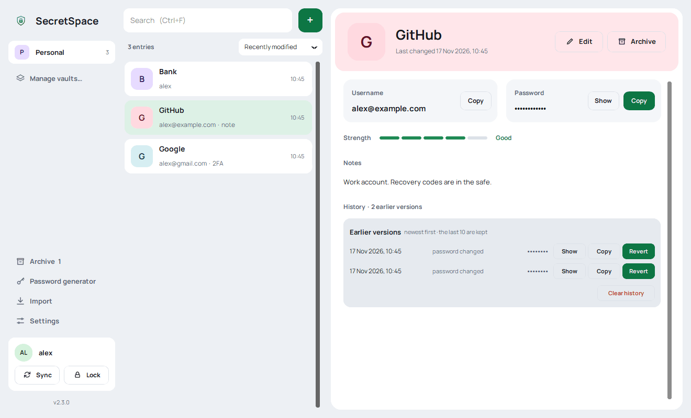
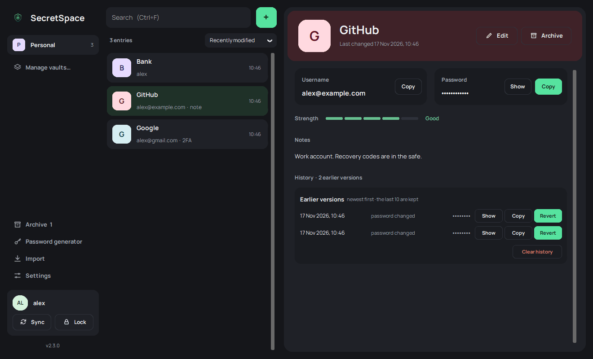
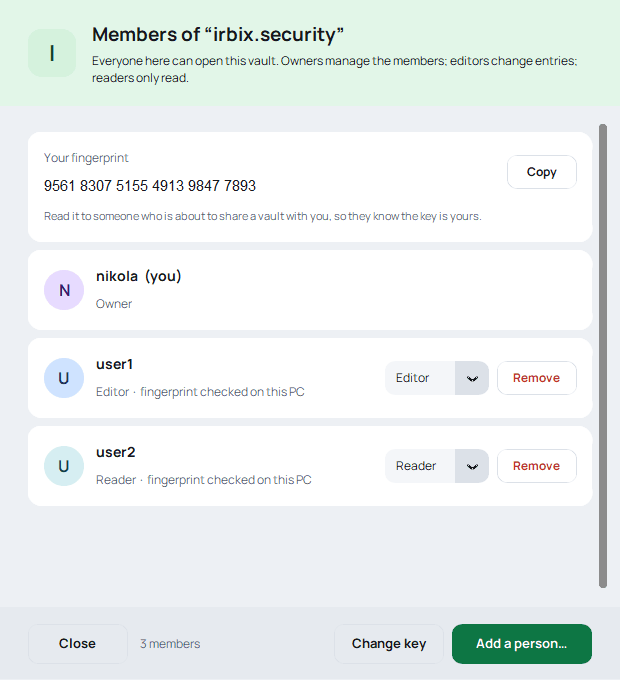
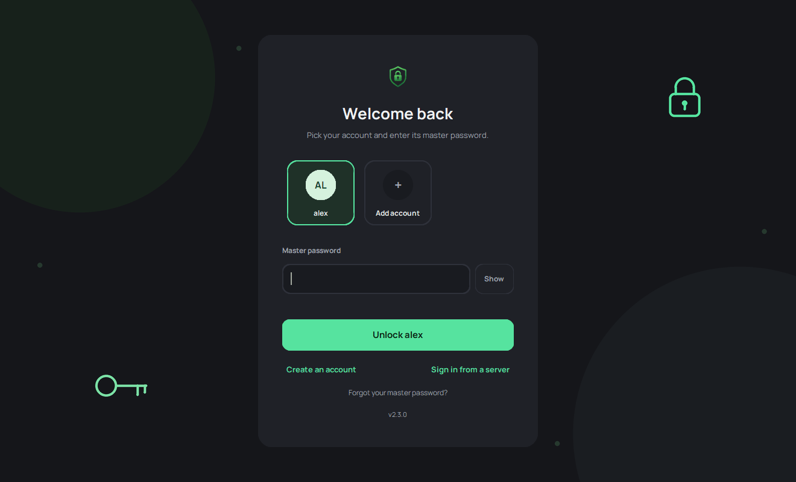

# SecretSpace for Linux

A desktop password manager that you run entirely yourself. Your passwords
are in encrypted vaults on your own PC (AES-256-GCM; the key comes from your
master password and a Secret Key, through Argon2id). There is no online
service behind it: it works offline, and if you want several devices in
step, or a vault shared with other people, you run the sync server yourself,
on your own hardware. (The one other address it can contact is github.com,
to see whether a newer version is out — only when you ask it to; see
[Updates](#updates).)

**Formerly PassMan.** The project was renamed to SecretSpace in November
2026, because another password manager already uses the name PassMan. The
names you see changed then; SecretSpace 3 (Linux 1.x) still carried the old
name where nobody looks — in the labels its keys are made with, in the
markers at the start of its files, in the name of its data folder. **Since
2.0.0 nothing the app makes carries the old name.** That is why 2.0.0 has a
new file format and converts an account from 1.x; the cryptography itself
is unchanged. (Releases up to 0.9.0 were the `passman` package; installing
`secretspace` replaces it in one step.)

**This README describes SecretSpace 4 for Linux** (2.3.0), the same
release as SecretSpace for Windows 4.4.0. Coming from 1.x? Read
[Upgrading from 1.x](#upgrading-from-1x) first: your account is converted
the first time you unlock it. Coming from 0.x? Read
[Upgrading from 0.x](#upgrading-from-0x). The 0.x line — one vault file per
user, last release
[0.11.0](https://github.com/usermaneGermane/SecretSpace-Client-Linux/releases/tag/v0.11.0) —
is finished; its README is on the branch
[`release-0.x`](https://github.com/usermaneGermane/SecretSpace-Client-Linux/tree/release-0.x).

It installs with apt (or from a `.deb`) on Ubuntu 22.04 or newer, or runs
from source. CI tests it on Ubuntu 22.04 and 24.04 on a virtual display,
and 2.2.0 has been used on an Ubuntu desktop with a real account.

| Light | Dark |
|---|---|
|  |  |
|  |  |

*Pictures of SecretSpace for Linux 2.3 with made-up test data.*

| Repository | What it holds |
|---|---|
| [SecretSpace-Client-Windows](https://github.com/usermaneGermane/SecretSpace-Client-Windows) | the app for Windows |
| **SecretSpace-Client-Linux** (this one) | the app for Linux |
| [SecretSpace-Server-Windows](https://github.com/usermaneGermane/SecretSpace-Server-Windows) | the sync server for Windows, with an installer |
| [SecretSpace-Server-Linux](https://github.com/usermaneGermane/SecretSpace-Server-Linux) | the sync server for Linux, run by systemd |

**The same as on Windows.** The account and vault files, the sync protocol
and the features match SecretSpace for Windows (see the version table under
*What is different from Windows*): 1.0.0 = Windows 3.0.0, 1.1.0 =
Windows 3.1.0, 2.0.0 = Windows 4.0.0. An account moves
between a Windows PC and a Linux PC through the server, and both sync with
either server.

## What SecretSpace is

1.0.0 is the same release as [SecretSpace for Windows
3.0.0](https://github.com/usermaneGermane/SecretSpace-Client-Windows#what-secretspace-3-is), whose README
describes each part in full:

- **Accounts** instead of one vault file per user, with a **Secret Key**
  (in your Emergency Kit) and a **12-word recovery phrase**; the key comes
  from the master password and the Secret Key through Argon2id.
- **Several vaults** in one account (*Vaults* above the list), each with its
  own key.
- **Sync** through your own SecretSpace Server **2.1.0** or newer
  (*Settings → Sync → Set up…*; on another device *Sign in from a server*).
- **Changing the server's address or certificate:** *Settings → Sync →
  Edit…* has them filled in; change one or both, *Save & sync*. No need to
  disconnect and no token (the token only creates an account on a server).
- **HTTPS** once the server has it (its `tls` command): copy the server's
  `server.crt` here, then in *Settings → Sync → Edit…* change `http://` to
  `https://` — same address and port — and choose that file as the
  certificate file. It is the same server, so every vault keeps its sync
  state; the app trusts that certificate only.
  The account and its vaults are files on this PC, so they open with no
  network at all.
- **Sharing a vault** with other accounts of the same server (*Vaults →
  Members*: owner, editor or reader, a fingerprint check before the first
  share, and *Remove* gives the vault a new key). Vault keys are signed, so
  a dishonest server cannot slip in a key of its own.
- **Who changed what** (*Vaults → Activity*), a signed record in every
  vault — never of who viewed or copied a password.
- **Recovery:** *Forgot your master password?* on the login screen opens the
  account with the 12-word phrase, sets a new password and makes a new
  phrase.
- **Importing 0.x / 2.x vaults** with their history and archive.

Not in 1.0: a company setup (admin console, invites), adding someone before
they have an account, moving an entry between vaults, and *Sync when I
unlock* (0.x has it; here you press **Sync**).

On Linux:

- **The Secret Key is kept under your master password** (Argon2id, then
  AES-GCM), not by the system as Windows does with DPAPI. So a copy of the
  account folder opens on another PC with the master password alone; keep
  your backups as private as your vault files. The desktop keyring may take
  this over later. It also means that **after a recovery the account gets a
  new Secret Key** (the stored one is sealed under the forgotten password):
  save the new Emergency Kit the recovery shows you.
- The account folders are `700` and their files `600`, like the vault
  folder; a saved Emergency Kit is `600` too.
- *Settings → Backup → Open folder* opens the folder with `xdg-open`.

| File | What it is |
| --- | --- |
| `accounts/<name>/account.json` | nothing secret, and the Secret Key sealed under your master password |
| `accounts/<name>/keyset.ssk` | the account's keys, under master password + Secret Key |
| `accounts/<name>/recovery.ssk` | the same keys, under the 12-word recovery phrase |
| `accounts/<name>/vaults/<id>.ssv` | one vault's entries (+ `.bak`) |

They sit beside the `vault` folder described under *Where your data lives*,
which holds 0.x vaults and is only read, for *Import*.

## New in 2.6: versions are checked

- **The app and the server tell each other their versions.** Settings → Sync
  shows the server's after a sync. A server can ask for a minimum app version
  and then says so plainly instead of failing half-way.
- **Long messages wrap** instead of being cut off at the edge of the window.
- **A vault can say which version it needs.** When a newer SecretSpace adds
  something this version could damage, it marks the vault; here it then opens
  **read-only**, with the version to update to. Nothing marks vaults yet.
- Changes you made on this PC before it heard of the mark are not merged by
  this version and not lost: they stay on this PC, the other vaults sync as
  usual, and they merge once SecretSpace is updated.
- **Older versions do not know the mark.** It protects from this version on.
- The app's version goes to your own sync server only.

## New in 2.5: nothing from a newer version is lost

- **Fields this version does not know are kept.** When a newer SecretSpace
  adds something to your entries or vaults, this version keeps it through
  saving, editing, syncing, the history and a shared vault's change log, even
  though it cannot show it. Until now it was dropped, and the loss synced to
  your other devices (as the web address of 4.5 / 2.4 could be).
- Reverting an entry brings such a field back with the rest; a version that
  did not have it leaves it alone. In a sync conflict the side that has any
  says *details from a newer SecretSpace*.
- **This protects from here on.** Devices still on an older version drop
  such fields as before, so update every device.
- Which versions work together is now in one place: [Compatibility](#compatibility).

## New in 2.4: a name and a web address

- **Two fields where there was one.** An entry has a **Name** (what you call
  it: "GitHub", "Work mail") and, optionally, a **Web address**
  (`github.com/login`). The old "Website / App" field is now the Name, so
  every entry you already have keeps what you typed there; the web address
  starts empty — fill it in when you edit the entry.
- **The address is a link.** On the entry's card it shows underlined; a left
  click opens it in your default browser (through `xdg-open`), and *Copy*
  copies it. Only `http://` and `https://` addresses are links: anything
  else (`file:`, `javascript:`, …) is refused when you save, and an address
  like that which is already in a vault — a shared vault can be written by
  others — is shown as plain text and never opened. Type `github.com` and it
  is saved as `https://github.com`.
- **Search finds an entry by its address too.**
- **Import keeps both.** A Chrome, Bitwarden, LastPass or KeePass export
  brings the entry's name *and* its address (before, the address was cut
  down to a name and the rest dropped). The CSV export fills the `url`
  column.
- Changing the address is an edit like any other: it is in the entry's
  history, can be reverted, and shows as "web address" in a shared vault's
  change log.
- ⚠️ **Update every device to 2.4 (Windows: 4.5) before you fill in
  addresses.** An older version does not know the field: when it saves an
  entry it leaves the address out, and that edit then syncs to your other
  devices. Nothing else is lost, and the account format does not change.

## New in 2.3: the finishing of the look

The same release as SecretSpace for Windows 4.4.0.

- **Readable everywhere.** Every text colour meets WCAG AA (4.5 : 1) on every
  surface it can appear on, in light and dark; a test checks all of them.
  Fixed on the way: red buttons whose text vanished under the pointer, the
  chosen option in the sync conflict window, red text on dark cards.
- **One scale for type, space and corners.** Sizes come from a named scale
  (title, heading, body, …; spacing in steps of 4) instead of numbers typed
  per screen, so dialogs line up. Some are a few pixels taller.
- **Dialogs stay on the screen.** A tall dialog could open with its buttons
  below the bottom of the screen when the main window sat low.
- **A sharper icon,** cropped to the shield, in every size the desktop looks
  for (16 to 512 px; the package had only 512) and in three for the window,
  so menus, the dock and the title bar each get one drawn for them.
- **Smaller fixes:** the "copied" message no longer sits across the edge of
  the entry's card; the Import window shows a long folder path in full.
- Nothing changes in what the app stores: it opens the same accounts.

**2.3.1** ties the running window to its menu entry: the dock showed it as a
separate, unnamed app ("tk") beside SecretSpace's own icon, because the
window did not carry the class name (`secretspace`) the entry names.

## New in 1.1: the look

- **Light and dark.** The app follows the desktop; *Settings → Appearance*
  chooses one.
- **A typeface of its own**, Manrope, and line icons the app draws itself.
- **The main window has three columns:** your vaults down the left (with
  how many entries each has, and "shared" where other people are in it),
  the entries, and the selected entry. *Sync* and *Lock* sit with your
  account at the bottom left.
- Entries, vaults and members are cards of their own, with pastel tiles.
- Nothing changes in what the app does or stores: it opens the same
  accounts, and going back to 1.0.0 is just installing that package again
  (`sudo apt install --allow-downgrades ./secretspace_1.0.0_all.deb`).

1.1.0 is the same release as SecretSpace for Windows 3.1.0.

## Upgrading from 1.x

2.0.0 writes accounts in a new format and **converts an account from 1.x
the first time you unlock it**. Your entries, vaults, master password and
12 recovery words stay the same. What you need to know first:

- **SecretSpace 1.x (and Windows 3.x) cannot open a converted account.**
  Update SecretSpace on **every device** that uses the account before you
  sync them again; a device still on the old version is refused by the
  server afterwards (its message speaks of a changed master password — it
  means "update me").
- **The sync server must be 2.1.0 or newer.** Update it first; it keeps
  serving older apps. Until then 2.0.0 works on your PC and says the server
  is too old when you press Sync.
- **Your Emergency Kit stays valid.** A Secret Key printed by 1.x starts
  with `A3-`; 2.0.0 accepts it and shows the same key as `A4-…`.
- **Fingerprint digits change.** The digits two people compare before
  sharing a vault are new in this version. Nothing you already compared
  has to be compared again, but compare with someone only once you have
  both updated: an older app shows other digits for the same account.

The steps:

1. **Back up first.** Close SecretSpace and copy `~/.local/share/secretspace`
   (or `~/.local/share/passman`, if that is the one you have).
2. **Update the server** to 2.1.0, if you sync.
3. **Install 2.0.0** (below). At its first start the app renames the data
   folder `~/.local/share/passman` to `~/.local/share/secretspace`, if
   yours still had the old name (renamed, not copied).
4. **Unlock.** After your master password, SecretSpace says the account
   will be converted. *Save a copy first…* puts a copy of the account as it
   is in a folder you choose; *Convert* does it. It needs no network.
5. **Type your 12 recovery words once**, when asked. The recovery copy opens
   only with those words, so only you can have it converted; the words stay
   the same. You can do it later (Settings → Security → *Recovery copy*).
6. **Sync.** The server is told about the conversion, and your vaults are
   stored in the new format. A vault you **share** moves to the new format
   by itself once every member has updated and unlocked once; until then it
   stays readable for a member on the older version.

**Going back.** Install 1.1.0 again
(`sudo apt install --allow-downgrades ./secretspace_1.1.0_all.deb`) and put
back the copy of the account you saved in step 4, or the backup from step 1.

The formats, and how a conversion keeps an account's keys and signatures
valid, are described in the Windows app's README under
[The account files](https://github.com/usermaneGermane/SecretSpace-Client-Windows#the-account-files);
they are the same here.

## Upgrading from 0.x

SecretSpace 3 does not open 0.x vaults directly: you make an account and
**import** them. **Your 0.x vaults are never converted, changed or
deleted**, so the way back stays open.

1. **Back up first.** Close SecretSpace and copy `~/.local/share/secretspace`
   (or `~/.local/share/passman`, if that is the one you have).
2. **Install the latest release** (below). It replaces the 0.x package; the data folder
   is left as it is.
3. **Create an account.** The login screen is empty at first — your 0.x
   vaults are not shown there. Save the Emergency Kit and write down the
   12-word phrase.
4. **Import.** Press *Import*, pick a vault from the list and enter its
   master password. Its entries arrive whole, with history and archive, in
   the vault that is shown.
5. **Sync.** The old sync settings are not carried over. Update your server
   to **2.1.0** (it keeps serving 0.x and 2.x apps exactly as before), then
   use *Settings → Sync → Set up…*.

**Going back.** Install the
[0.11.0](https://github.com/usermaneGermane/SecretSpace-Client-Linux/releases/tag/v0.11.0)
package again (`sudo apt install --allow-downgrades ./secretspace_0.11.0_all.deb`).
It opens your 0.x vaults as you left them. What you added in SecretSpace 3
stays in the account: there is no sync between a 0.x vault and an account.

## Installing it

### With apt (recommended)

On Ubuntu 22.04 or newer, or Debian 12 or newer. Add the SecretSpace apt
repository once (its key signs the packages, and apt trusts it for this
repository only), then install:

```bash
sudo install -d -m 0755 /etc/apt/keyrings
curl -fsSL https://usermanegermane.github.io/SecretSpace-apt/secretspace.gpg \
  | sudo tee /etc/apt/keyrings/secretspace.gpg > /dev/null
echo "deb [signed-by=/etc/apt/keyrings/secretspace.gpg] https://usermanegermane.github.io/SecretSpace-apt stable main" \
  | sudo tee /etc/apt/sources.list.d/secretspace.list
sudo apt update
sudo apt install secretspace
```

From then on `sudo apt upgrade` updates SecretSpace with everything else.
More about the repository and its key:
[SecretSpace-apt](https://github.com/usermaneGermane/SecretSpace-apt).

**On a fresh Ubuntu**, apt may answer *"has unmet dependencies … is not
installable"* for `python3-tk`, `python3-argon2` or `python3-pil.imagetk`.
That means its package lists are not downloaded yet, or the *universe*
section is off (Argon2 is in universe). Run these, then the install again:

```bash
sudo apt update
sudo add-apt-repository universe     # Ubuntu only; Debian has no universe
sudo apt update
```

### From a .deb file

The package is `secretspace_<version>_all.deb`. Download it from
[Releases](https://github.com/usermaneGermane/SecretSpace-Client-Linux/releases)
(the release marked **Latest**; checksums in `SHA256SUMS.txt`; a
*Pre-release* is a test version), or build it yourself on Ubuntu or Debian.
CI also keeps a `secretspace-deb` artifact of each run on `main`; that one may
be ahead of the release and is for testing only.

```bash
sudo apt install git python3-pip
git clone https://github.com/usermaneGermane/SecretSpace-Client-Linux.git
cd SecretSpace-Client-Linux
python3 deb/build_deb.py          # writes build/secretspace_<version>_all.deb
```

Then install it — apt pulls in Tk, cryptography, Argon2 (`python3-argon2`, in
the *universe* section, on by default on Ubuntu desktops) and Pillow from Ubuntu
(if it says they are not installable, see *On a fresh Ubuntu* above):

```bash
sudo apt install ./build/secretspace_*_all.deb
```

SecretSpace is then in the application menu, and `secretspace` starts it from a
terminal. `sudo apt remove secretspace` removes the program and leaves your
vaults alone.

| Installed file | What it is |
| --- | --- |
| `/usr/bin/secretspace` | starts the app |
| `/usr/lib/secretspace/` | the program and the libraries it bundles (customtkinter, darkdetect, packaging — pinned by hash in `deb/vendor.txt`) |
| `/usr/share/applications/secretspace.desktop` | the menu entry |
| `/usr/share/icons/hicolor/*/apps/secretspace.png` | its icon, 16 to 512 px |

### Updates

SecretSpace does not update itself. *Settings → Updates → Check now* asks
github.com for the newest release of this app and tells you whether there
is one; if there is, it offers to open its download page. Installed with
apt, `sudo apt upgrade` installs it (the repository picks up a new release
within a day); installed from a `.deb` file, you install the new one with
`sudo apt install ./secretspace_*_all.deb` as before. Either way your
accounts and vaults stay where they are. The switch *Check when
SecretSpace starts* — off until you turn it on — does the same check quietly
at each start and only speaks up when a new version is out.

A check is one HTTPS request to `api.github.com`; nothing about you or your
vaults is in it (GitHub sees your address, as any website would). Nothing
is downloaded or installed by the app.

## Running from source

On Ubuntu 22.04 or newer (other desktops with Python 3.10+ and Tk work the
same way):

```bash
sudo apt install python3-tk python3-venv git
git clone https://github.com/usermaneGermane/SecretSpace-Client-Linux.git ~/SecretSpace-Client-Linux
cd ~/SecretSpace-Client-Linux
python3 -m venv .venv
.venv/bin/pip install -r requirements.txt
.venv/bin/python sourceFiles/gui.py
```

After that, starting it is the last line, from that folder.

## Where your data lives

Run from a checkout, as above, the files are in the checkout itself, next
to `sourceFiles/` — the same rule as a portable copy on Windows. The
package keeps them in **`~/.local/share/secretspace`**
(or `$XDG_DATA_HOME/secretspace`) instead, so that upgrading or removing it never
touches them. (A folder `~/.local/share/passman` from before the rename is
renamed to that at the app's first start.) `SECRETSPACE_DATA_DIR` points the app at any other vault folder.

**Lab and production.** The package is the production copy. A checkout is a
handy lab copy beside it: it never touches `~/.local/share/secretspace`, and its
window title says `[LAB - <its vault folder>]` (the package's never does).
If both sync to the same server, give lab accounts names your real accounts
do not use — the server has one account per name.

Your account is in the `accounts` folder there (see the table under *What
SecretSpace 3 is*). The `vault` folder beside it holds 0.x vaults, if you
had any:

| File | What it is |
| --- | --- |
| `vault/<user>.vault.enc` | a 0.x vault; SecretSpace 3 only reads it, for *Import* |
| `vault/<user>.vault.enc.bak` | its previous version |
| `vault/<user>.vault.enc.base` | its sync state with a 1.x server |
| `config.json` | non-secret preferences (last username, auto-lock delay, sort order) |

The vault files are readable by your user only (`600`), and so is the
`vault` folder (`700`) when SecretSpace creates it. A plaintext CSV export is
created `600` too — it holds every password in the clear, so delete it once
it has done its job.

**Moving an account from Windows:** put it on a server there (*Settings →
Sync → Set up…*) and use *Sign in from a server* on the login screen here,
with the Secret Key from your Emergency Kit.

## What is different from Windows

- **Clipboard.** SecretSpace uses Tk's own clipboard, so nothing like `xclip`
  needs installing. It works on X11 and, through XWayland, on Wayland. On
  X11 what SecretSpace copied disappears when SecretSpace closes. As on Windows,
  locking leaves a copied password pasteable, closing clears it at once, and
  copied passwords are cleared after 30 seconds — but a clipboard manager
  (GNOME or KDE clipboard history, CopyQ, …) may keep its own copy, which
  no application can reach.
- **Fonts.** From 1.1 the app brings its own typeface, Manrope (SIL Open
  Font License); it is copied to `~/.fonts` at the first start, which is
  how the toolkit makes a font known. Codes and fingerprints use DejaVu
  Sans Mono, which Ubuntu ships.
- **Light and dark** *(1.1)* follow the desktop where it reports one
  (GNOME's colour scheme, or a theme whose name ends in `-dark`), asked
  **once, at start**: change the desktop while SecretSpace runs and it
  follows at the next start. *Settings → Appearance* chooses one either
  way.
- **A package instead of an installer.** The `.deb` does what the Windows
  installer does: a menu entry, data in your home folder, removal that keeps
  the vaults. Unlike the Windows installer it does not offer to move a vault
  from a copy run from source — copy the `vault` folder into
  `~/.local/share/secretspace` yourself.

Everything else — syncing, the archive, revision history, 2FA codes,
importing from other password managers, and the security notes and limits — works and
reads exactly as in [SecretSpace for Windows's
README](https://github.com/usermaneGermane/SecretSpace-Client-Windows#syncing-your-devices).
Where that README names a Windows version, read the Linux one beside it:

| Windows | Linux | What arrived |
|---|---|---|
| 2.3.0 | 0.1.0 | the Linux app |
| 2.4.0 | 0.3.0 | deleting archived entries after N days |
| 2.5.0 | 0.4.0 | switching servers no longer removes entries silently |
| 2.6.0 | 0.5.0 | a copy that is not installed says LAB in its title |
| 2.7.0 | 0.7.0 | the redesigned window |
| 2.8.0 | 0.6.0 | locking no longer clears a copied password |
| 2.9.0 | 0.7.0 | the dialogs redesigned to match |
| 2.10.0 | 0.8.0 | 2FA codes, behind the master password |
| 2.11.0 | 0.9.0 | sync on unlock, a setting that is off by default |
| 2.12.0 | 0.10.0 | renamed to SecretSpace (package `secretspace`, replaces `passman`) |
| 2.13.0 | 0.11.0 | a smoother look, for the stable line (same as alpha.4 below) |
| 3.0.0-alpha.1 | 1.0.0-alpha.1 | PassMan 3 test: accounts, Emergency Kit, recovery phrase, 2.x import |
| 3.0.0-alpha.2 | 1.0.0-alpha.2 | renamed to SecretSpace (package `secretspace`, replaces `passman`) |
| 3.0.0-alpha.3 | 1.0.0-alpha.3 | accounts sync through SecretSpace Server 2.0; sign in from a server |
| 3.0.0-alpha.4 | 1.0.0-alpha.4 | a smoother look: smoothed corners, redrawn sign-in backdrop |
| 3.0.0-alpha.5 | 1.0.0-alpha.5 | several vaults per account; Sync covers them all (Server 2.0.0-alpha.2) |
| 3.0.0-alpha.6 | 1.0.0-alpha.6 | sharing a vault (owner / editor / reader), who changed what (Server 2.0.0-alpha.3) |
| 3.0.0-alpha.7 | 1.0.0-alpha.7 | recovering an account with the 12-word phrase, a new phrase (Server 2.0.0-alpha.4) |
| 3.0.0-alpha.8 | 1.0.0-alpha.8 | security fix: signed vault keys (Server 2.0.0-alpha.5) |
| 3.0.0 | 1.0.0 | SecretSpace 3, the first release: everything from the alpha rows (Server 2.0.0) |
| 3.1.0-alpha.1, alpha.2 | 1.1.0-alpha.2 | the new look: light and dark, the Manrope typeface, vaults down the left of the main window |
| — | 1.1.0-alpha.3 | Linux only: the desktop is asked for light or dark once, not every 30 ms |
| 3.1.0-alpha.3 | 1.1.0-alpha.4 | icons drawn by the app, vault tiles in the Vaults window, no outlined cards |
| 3.1.0 | 1.1.0 | the new look, released: everything from the 3.1 / 1.1 alpha rows |
| 4.0.0 | 2.0.0 | nothing carries the project's old name any more: a new file format, accounts from 1.x are converted (Server 2.1.0) |

(0.2.0 added the `.deb` package, which has no Windows counterpart.)

## If you forget your master password

Nobody can open your account for you, and there is no backdoor. What opens
it without the master password is the **12-word recovery phrase** you wrote
down when you made the account: *Forgot your master password?* on the login
screen. Lose the master password **and** the phrase, and the passwords are
gone. **Make backups:** *Settings → Backup → Open folder* shows the
account's folder; copy it to another drive.

## Project layout

```
SecretSpace-Client-Linux/
├── sourceFiles/        the program — ported from SecretSpace-Client-Windows
│   ├── gui.py          app shell: login, account list, lifecycle
│   ├── clipboard.py    the clipboard, through Tk (Linux only)
│   ├── ...             the same modules as on Windows
│   └── tests/
│       └── sync_server/ a copy of the server, for the end-to-end sync tests
├── docs/screenshots/   the pictures in this README
├── deb/
│   ├── build_deb.py    builds the .deb
│   ├── icons/          the icon at each size (tools/make_icons.py draws them)
│   ├── secretspace.py      the launcher installed in /usr/lib/secretspace
│   └── vendor.txt      the libraries bundled into the package, pinned by hash
└── tools/
    ├── smoke_gui.py    starts the real app on a display and takes screenshots
    └── make_icons.py   draws deb/icons and sourceFiles/SecretSpace-icon.png from the logo
```

<!-- compatibility:start (the same text in all four repositories; tests/test_compatibility.py checks it) -->
## Compatibility

The apps and the servers each have their own version numbers, and they do
not line up: Windows 4.5 and Linux 2.4 are the same app. Versions in one row
belong together, and each needs a server of the version shown **or newer**,
for Windows or Linux alike.

| Windows app | Linux app | Server | Worth knowing |
|---|---|---|---|
| 4.6 and newer | 2.5 and newer | 2.1.0 | keeps what a newer version added to your vaults, even if it does not know it |
| 4.5 | 2.4 | 2.1.0 | the web address: update every device before you use it |
| 4.4 | 2.3 | 2.1.0 | |
| 4.3 | – | 2.1.0 | no Linux release |
| 4.0 – 4.2 | 2.0 – 2.2 | 2.1.0 | the current account format |
| 3.x | 1.x | 2.0.0 | the format before it; newer servers keep serving it |
| 2.x | 0.x | any | one vault file per user; finished |

- **Update the server first**, then the apps.
- **Every device of an account on 4.x / 2.x, or none.** Once one device has
  converted an account to the current format, 3.x / 1.x devices cannot sync
  it. A shared vault stays in the old format until every member's account
  is converted.
- **Before 4.6 / 2.5 an app drops entry fields it does not know** when it
  saves, and that then syncs to your other devices. Devices on different
  versions below that are fine as long as you do not use what only the newer
  one has (the web address of 4.5 / 2.4).
- **From 4.7 / 2.6 the versions are checked by themselves.** The app tells
  the server what it is, and the server (2.3.0 for Windows, 2.4.0 for Linux)
  can say that an app is too old. A vault can say which version it needs: an
  older app that knows the check opens it **read-only** instead of damaging
  it. Nothing asks for that yet. Older servers and apps work as before.
- **HTTPS with one command** needs server 2.2.1, and apps 4.0.1 / 2.0.1 to
  keep their sync state when the address changes.
<!-- compatibility:end -->

## Versioning

The version lives in `sourceFiles/version.py` and each release is tagged
`v<version>`. It is separate from the Windows app's; each release says which
Windows release it matches (2.3.0 is Windows 4.4.0). It was 0.x until the
Linux app was packaged and used for real; 1.x is SecretSpace 3, 2.x
SecretSpace 4.

## Development

```
pip install -r requirements-dev.txt
python -m pytest -q
```

GitHub Actions runs the tests on Ubuntu with Python 3.10, 3.12 and 3.13, and
`tools/smoke_gui.py` under a virtual display, which starts the app, unlocks
a throwaway vault, copies and clears a password, and keeps screenshots of
the login and main windows as the run's artifact.

The `deb` job, on Ubuntu 22.04 and 24.04, builds the package, installs it
with apt, runs the tests on the system's own Python, Tk, cryptography and
Pillow, runs the smoke test against the installed copy
(`tools/smoke_gui.py --installed`), starts `secretspace` as the menu would, and
removes the package again. The 24.04 run keeps the `.deb` as the
`secretspace-deb` artifact.

**Staying in step with Windows.** The modules here began as copies of
SecretSpace-Client-Windows's `sourceFiles/`; only `vault.py` (where data lives,
file modes), `gui.py` (clipboard, window icon), `theme.py` (fonts),
`version.py`, `password_generator.py` and the new `clipboard.py` differ. A
fix to the shared logic — the vault, sync, importers — belongs in both
repositories.

## License

SecretSpace for Linux is free software under the **GNU General Public License
v3.0 only** (GPL-3.0-only) — see [LICENSE](LICENSE). You may use, study,
change and share it; if you distribute a changed version, it must stay under
the same licence, with its source.

The other SecretSpace repositories (the Windows and Linux clients and sync servers)
are free software under the same licence.

The 12-word recovery phrase uses the BIP39 English word list from
[bitcoin/bips](https://github.com/bitcoin/bips/blob/master/bip-0039/english.txt).

Security issues: please report them privately, see [SECURITY.md](SECURITY.md).
